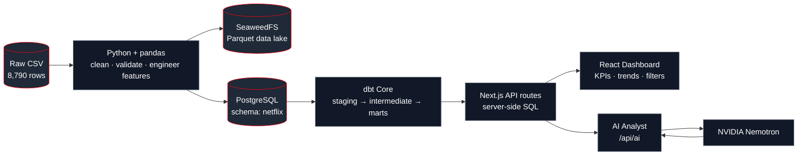
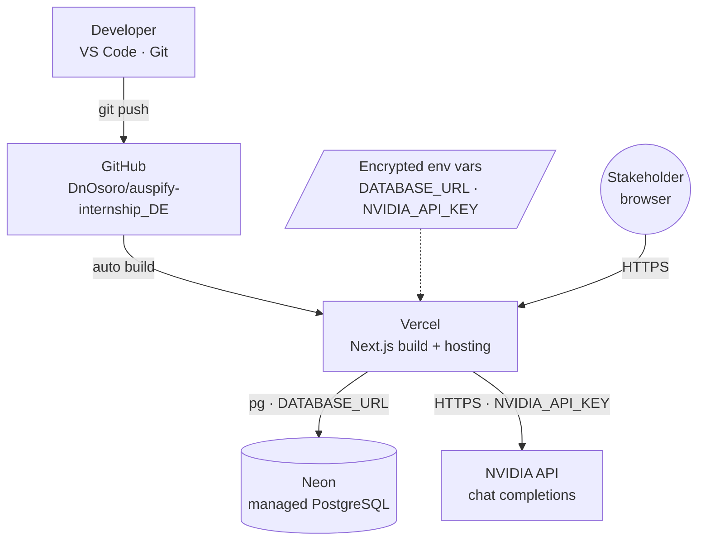
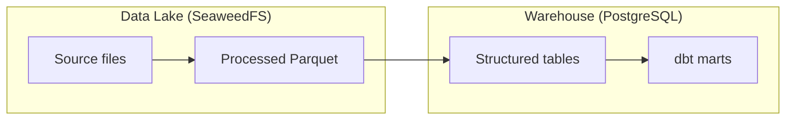
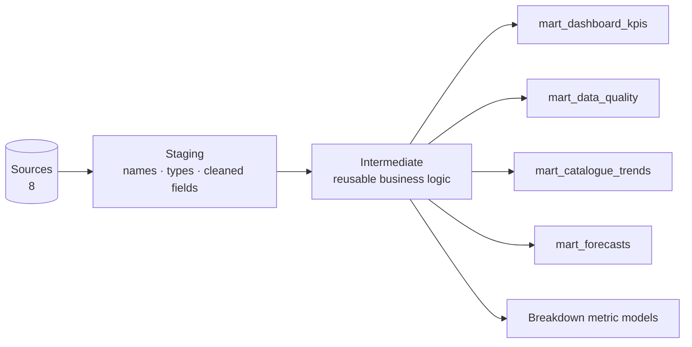
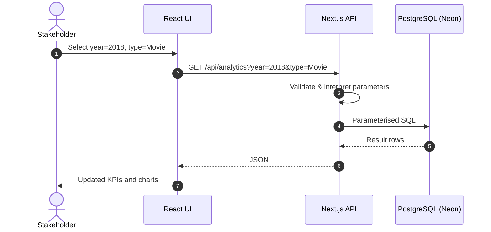
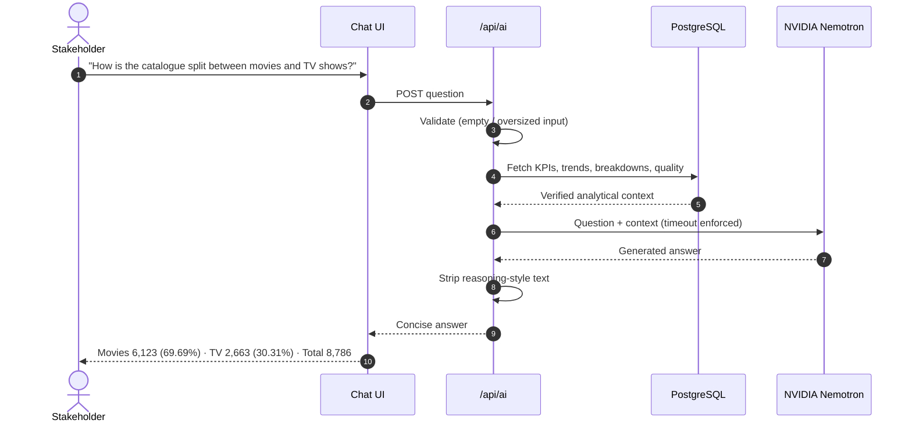

<div align="center">

# Auspify
### Netflix Catalogue Intelligence Platform

**An end-to-end analytics platform: raw CSV → data lake → PostgreSQL warehouse → dbt marts → Next.js analytics API → AI analyst, deployed on Vercel + Neon.**


[**Live Demo**](#) · [**Architecture**](#architecture) · [**Data Model**](#data-model-dbt) · [**AI Analyst**](#ai-analyst-design) · [**Limitations**](#known-limitations--roadmap)

</div>

---

## Overview

Auspify turns a raw Netflix titles dataset (**8,790 rows, 10 columns**) into a reliable, queryable analytics product that stakeholders can explore through an interactive dashboard and a natural-language AI assistant.

The guiding principle is **separation of responsibilities**:

| Layer | Responsibility |
|---|---|
| Python / pandas | Clean, validate and feature-engineer raw data |
| SeaweedFS + Parquet | Data-lake storage for raw and processed files |
| PostgreSQL | Relational warehouse and query engine |
| dbt Core | Versioned, tested transformation layer (staging → intermediate → marts) |
| Next.js API routes | Server-side analytics API; the browser never touches the database |
| NVIDIA Nemotron | Explains *verified* analytics context in natural language |
| Vercel + Neon | Hosted application and managed PostgreSQL |

### Headline results

| Metric | Value |
|---|---|
| Total titles (after cleaning) | **8,786** |
| Movies | **6,123** (69.69%) |
| TV Shows | **2,663** (30.31%) |
| Median movie runtime | **98 min** |
| Peak complete year for additions | **2019** (2,013 titles) |
| dbt build | **17 models · 88 tests · 8 sources** |

> The dataset runs only through **25 Sep 2021**, so 2021 is a partial year and must not be compared to full years.

---

## Architecture

### End-to-end pipeline



### Deployment topology



### Local vs. production

| Concern | Local development | Production |
|---|---|---|
| Object storage | SeaweedFS (Docker) | Not required by the deployed app |
| Database | Local PostgreSQL (Docker) | Neon PostgreSQL |
| Config | Local env settings | Vercel encrypted environment variables |
| App | `npm run dev` | Vercel deployment |

---

## Data Engineering

### 1 · Cleaning & feature engineering (`pandas`)

- Removed **4 duplicate** content records (8,790 → **8,786** rows)
- Standardised ratings; mapped `NR` and `UR` → `Not Rated`
- Represented missing directors / countries with explicit `Unknown` categories (nulls are *modelled*, not silently dropped)
- Parsed `date_added` into a proper date
- Split `duration` into `movie_minutes` and `tv_seasons` (a single numeric column cannot represent both `98 min` and `3 Seasons`)
- Expanded list-like fields into `country_list` and `genre_list`
- Derived `year_added`, `audience`, `years_to_add`, `added_before_release`

**Output:** `data/netflix_clean.csv` and `data_lake/processed/netflix_titles.parquet` (**8,786 rows × 26 columns**).

> **Why Parquet?** Columnar, type-preserving, and queries can read only the columns they need, unlike CSV.

### 2 · Data-quality profile

| Check | Result |
|---|---:|
| Duplicate content records removed | 4 |
| Missing / unknown directors | 2,587 |
| Missing / unknown countries | 287 |
| Unrated records standardised | 82 |
| Records added before release year | 14 |
| Movies under 40 minutes | 169 |
| Duplicate IDs after cleaning | 0 |

These are **surfaced, not auto-deleted**. A title can legitimately have no known director; the goal is accurate representation.

### 3 · Storage design



Storing a file and querying a business metric are different workloads, so they are different layers.

---

## Data Model (dbt)

**dbt Core 1.12.5** with the **PostgreSQL adapter 1.11.0**. Recorded full build: **17 models · 88 tests · 8 sources**.



| Mart | Purpose |
|---|---|
| `mart_dashboard_kpis` | Headline catalogue totals |
| `mart_data_quality` | Data-quality counts and checks |
| `mart_catalogue_trends` | Additions and patterns over time |
| `mart_forecasts` | Baseline forecast outputs |
| Breakdown models | Country / genre / rating metrics; median runtime via `PERCENTILE_CONT(0.5)` |

**Why dbt:** transformation logic is versioned, tested, traceable through dependencies, rebuildable, and kept out of the UI.

> Passing dbt tests validates *specific assumptions*; it does not prove every business interpretation is correct.

---

## Analytics API

The browser never receives database credentials. All SQL runs server-side inside Next.js API routes.

| Route | Responsibility |
|---|---|
| `/api/kpis` | Headline metrics |
| `/api/analytics` | Analytical results with filter support |
| `/api/trends` | Catalogue trends |
| `/api/countries` | Country breakdowns |
| `/api/genres` | Genre breakdowns |
| `/api/ratings` | Rating breakdowns |
| `/api/data-quality` | Global data-quality metrics |
| `/api/filtered-data-quality` | Data quality under active filters |
| `/api/filter-options` | Available filter values |
| `/api/ai` | AI analyst requests |

### Request flow (filtered query)



Local verification: filtering to **2018** returned **1,647** titles before restricting by type.

---

## AI Analyst Design

**Model:** `nvidia/nemotron-3.5-lightning-30b-a3b` via NVIDIA's chat-completions API.

### Grounded, not free-form

User questions are **never executed as SQL**. The server gathers a **controlled set of analytics** (KPIs, trends, countries, genres, ratings, data quality) and passes it to the model as context.



**Safeguards:** request validation · input-size limits · timeouts · error handling · reasoning-text stripping · no arbitrary SQL.

**Boundary:** the model answers what the supplied context supports. It does not automatically know every fact in the database.

---

## Exploratory Analytics & ML Experiments

Separate from the production dashboard:

| Experiment | Result |
|---|---|
| Random Forest classifier | 97.67% held-out accuracy |
| Logistic Regression | ≈ 97.61% |
| TF-IDF feature matrix | 8,786 × 6,552 |
| Baseline forecast (2021–2025 window) | 953 additions |

> Accuracy alone does not establish usefulness. Target definition, train/test separation, potential leakage and business objective all matter. The forecast is a **baseline**, not a guarantee.

---

## Testing Strategy

Each layer catches a different failure class:

| Level | Tooling | Outcome |
|---|---|---|
| Type safety | `npx tsc --noEmit` | Passed |
| Linting | `npm run lint` | 0 errors, 5 non-fatal warnings (unused types/state) |
| Build | `npm run build` | Succeeded |
| API | Python scripts + HTTP | Status codes and JSON verified |
| Filters | Year 2018 scenario | Totals change as expected |
| AI | Summary, empty and oversized input, response handling | Verified |
| Local prod server | Built app on a local port | APIs tested before relying on hosted version |
| Data | dbt tests | 88 tests |

---

## Deployment

**Stack:** Git → GitHub → Vercel (app) + Neon (database).

### Required environment variables

| Variable | Purpose |
|---|---|
| `DATABASE_URL` | Neon PostgreSQL connection string (used by `lib/db.ts`) |
| `NVIDIA_API_KEY` | Authenticates requests to the NVIDIA API |

Set these in **Vercel's encrypted environment variables**, never in source code or the public repo.

### Production incident write-up

The first deployment built successfully but was not functional.

| Symptom | Root cause | Fix |
|---|---|---|
| `getaddrinfo ENOTFOUND base` in build logs | `DATABASE_URL` held the placeholder example, so the client resolved a host named `base` | Set the real Neon connection string |
| AI chat: *"The AI service is not configured."* | `NVIDIA_API_KEY` missing in production | Added key to Vercel environment variables |

**Lesson:** a green build is not a working system, and saving an env var does **not** update an already-built deployment. **Redeploy**, then verify the live DB endpoints and AI chat.

---

## Repository Structure

> Indicative layout. Adjust to match your repo.

```text
auspify-internship_DE/
├── data/
│   └── netflix_clean.csv
├── data_lake/
│   └── processed/netflix_titles.parquet
├── notebooks/                # Jupyter exploration
├── pipeline/                 # pandas cleaning & loading scripts
├── dbt/                      # staging · intermediate · marts · tests
├── dashboard/                # Next.js app
│   ├── app/api/              # kpis, analytics, trends, ai, ...
│   └── lib/db.ts             # pg connection (DATABASE_URL in prod)
├── docker-compose.yml        # SeaweedFS + PostgreSQL (local)
└── README.md
```

---

## Getting Started

> Commands are indicative. Adapt paths and filenames to your repo.

```bash
# 1. Clone
git clone https://github.com/DnOsoro/auspify-internship_DE.git
cd auspify-internship_DE

# 2. Start local infrastructure
docker compose up -d

# 3. Clean data and load PostgreSQL
python pipeline/clean.py

# 4. Build analytics models and run tests
cd dbt && dbt build && cd ..

# 5. Run the dashboard
cd dashboard
cp .env.example .env.local     # set DATABASE_URL and NVIDIA_API_KEY
npm install
npm run dev
```

---

## Tech Stack

| Category | Technologies |
|---|---|
| Processing | Python, pandas, Jupyter, scikit-learn, TF-IDF |
| Storage | SeaweedFS, Parquet, PostgreSQL, Neon |
| Transformation | SQL, dbt Core |
| Application | Next.js, React, TypeScript, Tailwind CSS, `pg` |
| AI | NVIDIA API, Nemotron |
| Delivery | Docker, Git, GitHub, Vercel |

---

## Known Limitations & Roadmap

Stated honestly, because scope matters:

**Current scope:** data lake, PostgreSQL analytics layer, dbt transformations, dashboard, ML experiments, AI analyst.

**Not implemented (yet):**
- [ ] Production orchestration (e.g. Airflow, Dagster, Prefect)
- [ ] Automated scheduled ingestion
- [ ] Comprehensive monitoring and alerting
- [ ] Enterprise-grade security hardening (auth, rate limiting, audit logging)
- [ ] CI pipeline running dbt tests on every pull request
- [ ] Evaluation harness for AI answer accuracy

---

## Key Engineering Takeaways

1. **Understand the source first**: profile before building charts (duplicates and nulls distort metrics).
2. **Keep business logic in the warehouse**, not the UI: dbt marts are the single source of truth.
3. **Ground the LLM in verified context** instead of letting it improvise or run arbitrary SQL.
4. **Test at every layer**: types, build, APIs, data and AI each fail differently.
5. **Treat configuration as a first-class failure mode**: most production bugs here were environment issues, not code.

---

<div align="center">

**Built by [DnOsoro](https://github.com/DnOsoro)** · Data Engineering Internship Project

</div>
